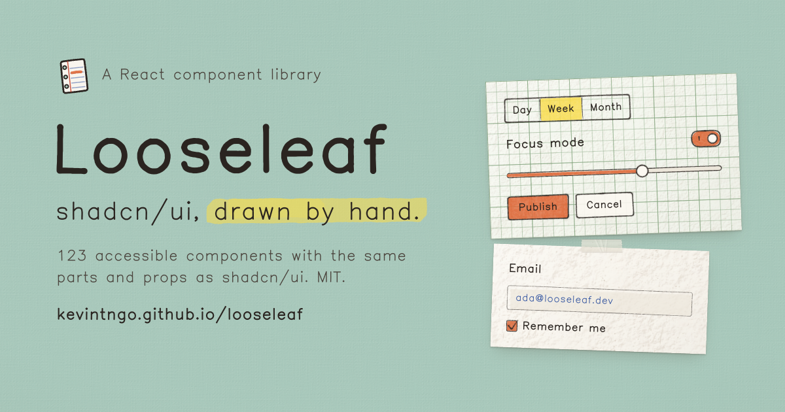

# Looseleaf Vue

**shadcn/ui，手绘在纸上。**

[在线文档](https://looseleaf-vue.banana-energy.cn/)



Looseleaf Vue 是 [Looseleaf](https://github.com/kevintngo/looseleaf) 的 Vue 3 + TypeScript 版本。它沿用上游的纸张质感、手绘线条、绘制算法和组件语义，并将组件适配为 Vue JSX 与 Reka UI。每个表面像纸张，每条线像钢笔画出来的一样；装饰不会改变普通表单和交互组件的可访问语义。

| | |
|---|---|
| **123 个组件** | 从 Button、Card、Dialog、Sidebar 到 Chart、Paper、Sticker 和 Sketchpad |
| **61 个区块** | 登录、注册、Dashboard、定价、聊天、笔记和落地页等页面区块 |
| **手绘素材** | 图标、涂鸦、贴纸、印章、纸张和 Stubby 吉祥物 |
| **Kevin Sans** | 用于界面文字、标题和印章的手绘字体 |
| **可访问** | 原生键盘交互、可见焦点、减弱动态效果和高对比度支持 |

## 安装组件

Looseleaf Vue 使用 [shadcn-vue registry](https://www.shadcn-vue.com/docs/registry) 分发源码。组件会复制到你的项目中，因此你拥有源码，可以按业务继续修改。

在项目的 `components.json` 中注册 registry：

```json
{
  "registries": {
    "@looseleaf": "https://looseleaf-vue.banana-energy.cn/r/{name}.json"
  }
}
```

然后使用 `shadcn-vue` CLI 添加组件：

```bash
pnpm dlx shadcn-vue@latest add @looseleaf/button
pnpm dlx shadcn-vue@latest add @looseleaf/card
pnpm dlx shadcn-vue@latest add @looseleaf/looseleaf
```

`looseleaf` 是完整主题入口，会带入纸张主题、字体、绘制引擎和组件依赖。只想添加单个组件时，安装对应名称即可；CLI 会把主题 CSS 合并到项目的全局样式中。

组件使用 Vue 组件语法：

```vue
<script setup lang="ts">
import { Button } from '@/components/ui/button'
import { InkProvider } from '@/lib/ink/vue'
</script>

<template>
  <InkProvider>
    <Button>Save changes</Button>
  </InkProvider>
</template>
```

如果项目还没有 shadcn-vue 配置，可以先执行 `pnpm dlx shadcn-vue@latest init`。Looseleaf Vue 的 registry 文件和依赖关系会从当前仓库生成，安装后请检查 CLI 即将写入的文件和依赖。

## 开发文档站

```bash
pnpm install
pnpm dev
```

常用校验：

```bash
pnpm lint
pnpm typecheck
pnpm build
```

修改组件或 registry 源文件后，先重新生成可被 CLI 读取的 JSON：

```bash
pnpm registry:build
```

生成结果位于 `public/r/`，`registry.json` 是源 registry 定义。

## 发布给其他人

项目使用 Vercel 托管文档站和 registry。部署构建会先执行 `pnpm registry:build`，再执行 `pnpm build`，因此 `public/r/` 会和当前源码保持同步。将变更推送到 GitHub 后，Vercel 的 Git 集成会为主分支创建生产部署，为其他分支和 Pull Request 创建预览部署。

部署完成后，用户只需要在自己的 Vue 项目中注册上面的 URL，并执行 `shadcn-vue add` 命令即可使用。这个分发方式与 npm 包不同：组件源码进入用户项目，用户可以直接查看和修改实现。

## 工作原理

绘制层使用独立的 `<svg data-ink>` 放在真实 DOM 内容后方。绘制函数是带 seed 的纯 TypeScript 函数，同一个 seed 在服务端和浏览器中会得到相同的线条；颜色、笔宽和密度通过 CSS 变量控制，交互状态由 CSS 与预先绘制的图层处理。

## License

代码、绘制素材和 Kevin Sans 使用 MIT；IBM Plex Mono 使用 SIL OFL 1.1。
